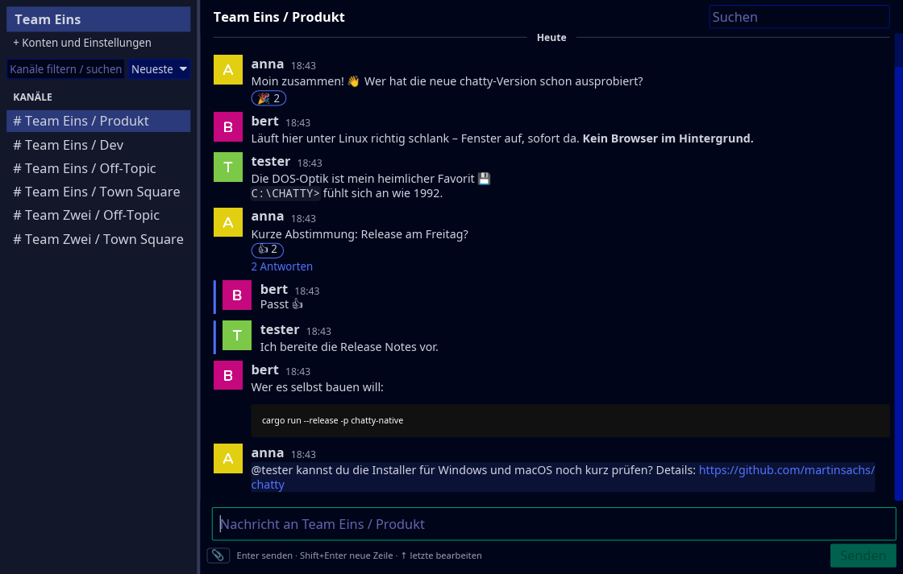
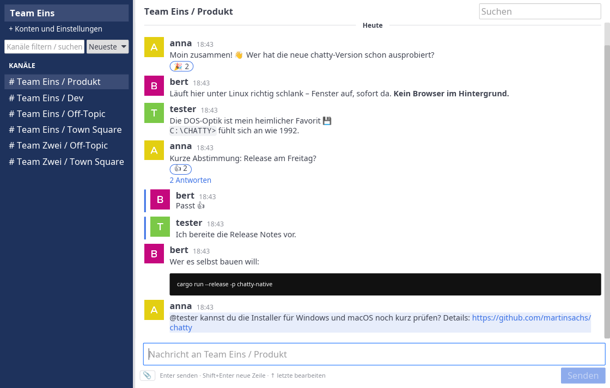
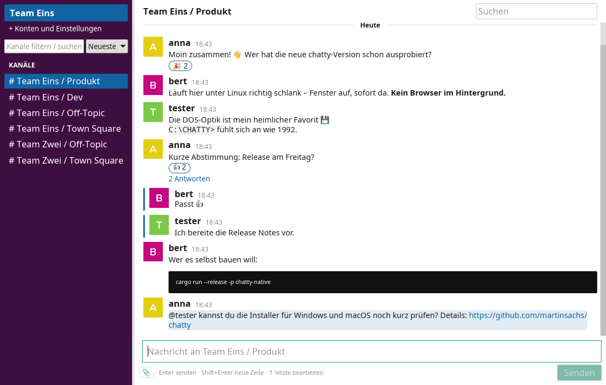
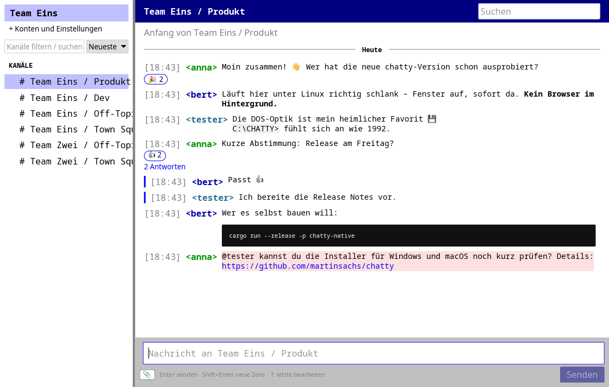
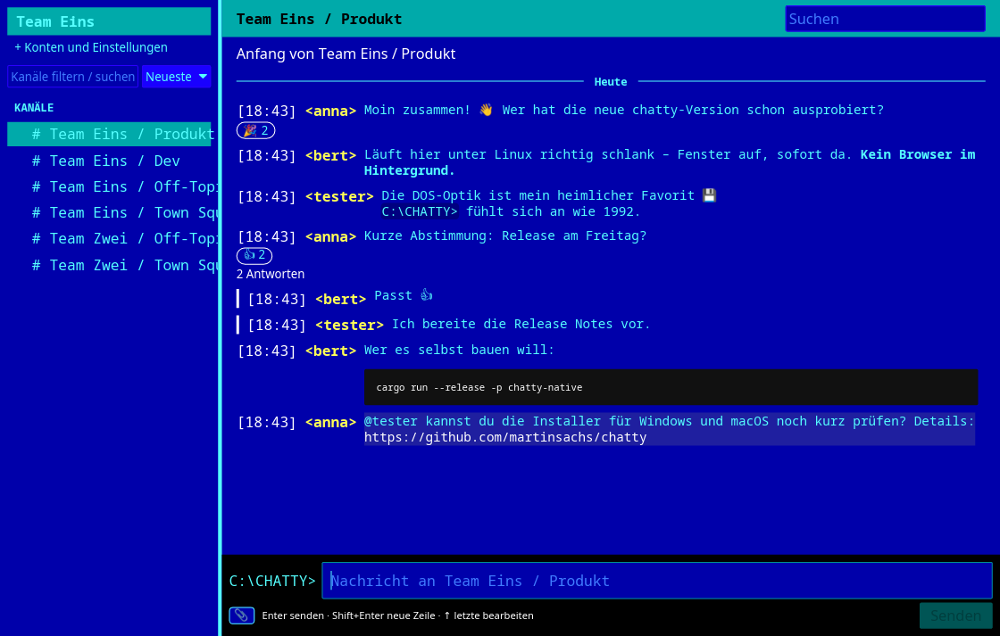

<p align="center">
  
</p>

<h1 align="center">chatty</h1>

<p align="center"><b>Alle Chats. Ein Fenster. Kein Ballast.</b></p>

<p align="center">
  <a href="https://github.com/martinsachs/chatty/releases/latest"></a>
  <a href="https://github.com/martinsachs/chatty/actions/workflows/build.yml"></a>
  <a href="LICENSE.txt"></a>
  
  <a href="#mit-ki-entwickelt"></a>
</p>

<p align="center">
  
</p>

**chatty** bringt **Google Chat** und **Mattermost** in eine schlanke Desktop-App: alle Konten
nebeneinander, Benachrichtigungen nur, wenn es dich betrifft. Kein Browser-Tab, der im Hintergrund Speicher
frisst, kein Wechseln zwischen Fenstern – einfach chatten.

Wähle deinen Stil: aufgeräumt wie **Mattermost** oder **Slack**, dunkel in **ehex**-Farben – oder mit
Nostalgie im **mIRC**-Look und als **DOS**-Oberfläche im Stil des Norton Commander.

- ⚡ **Leicht und schnell** – wahlweise als native App ganz ohne eingebetteten Browser
- 💬 **Ein Fenster für alles** – mehrere Konten, Kanäle, Direktnachrichten, Threads und Reaktionen
- 🔔 **Nichts verpassen** – Desktop-Benachrichtigungen bei Direktnachrichten und Erwähnungen, ungelesene
  Kanäle auf einen Blick
- 🔒 **Deine Daten bleiben bei dir** – Zugangsdaten im Schlüsselbund des Betriebssystems, keine Telemetrie,
  keine Werbung
- 🎨 **Fünf Optiken** – zur Laufzeit umschaltbar
- 🔄 **Immer aktuell** – signierte Updates mit einem Klick
- 🆓 **Open Source** – kostenlos, Apache-2.0-Lizenz, für Linux, Windows und macOS

### Fünf Optiken – zur Laufzeit umschaltbar

<table>
  <tr>
    <td align="center"><br><b>Mattermost</b> – hell und aufgeräumt</td>
    <td align="center"><br><b>Slack</b> – Aubergine-Seitenleiste</td>
  </tr>
  <tr>
    <td align="center"><br><b>mIRC</b> – <code>[12:34] &lt;nick&gt;</code> wie 1998</td>
    <td align="center"><br><b>DOS</b> – blaue Panels à la Norton Commander</td>
  </tr>
</table>

Oben im Bild: **ehex** – dunkel, in den Farben von ehex.de. Alle Bilder zeigen chatty-native mit Demo-Daten.

### Mit KI entwickelt

chatty ist ein KI-gestütztes Projekt: Code, Tests, Konzepte, Optiken und auch diese Beschreibung sind
überwiegend mit [Claude Code](https://claude.com/claude-code) (Anthropic) entstanden. Der Maintainer hat
Anforderungen und Entscheidungen vorgegeben, Ergebnisse geprüft und freigegeben; Commits mit KI-Anteil tragen
den Vermerk `Co-Authored-By: Claude`. Wie bei jeder Software können Fehler enthalten sein – siehe
[Lizenz und Rechtliches](#lizenz-und-rechtliches).

### Herunterladen

Installer für Linux (deb, AppImage, rpm), Windows (Setup, msi) und macOS (dmg) unter
[**Releases**](https://github.com/martinsachs/chatty/releases/latest). Zwei Varianten mit nahezu gleichem
Funktionsumfang ([Unterschiede](konzept/drift-native-tauri.md)):

| Variante | Für wen |
|---|---|
| **chatty** | Volle Darstellung mit Web-Technik (Tauri), abgelöste Chatfenster, Favoriten per Drag&Drop |
| **chatty-native** | Minimaler Speicherbedarf, native Oberfläche ohne eingebetteten Browser |

Einrichtung und Bedienung: [usage.md](usage.md).

---

## Funktionen

- Konten: Google Chat (OAuth-Login im Browser) und Mattermost (Benutzer/Passwort, MFA), beliebig viele
- Spaces, Kanäle, Direkt- und Gruppennachrichten mit Ungelesen- und Erwähnungsanzeige
- Lesen, Senden, Bearbeiten, Löschen, Threads (rechte Seitenleiste; bei Mattermost Antworten zusätzlich im
  Verlauf, mit Balken markiert), Emoji-Reaktionen
- Dateianhänge hoch- und herunterladen
- Serverseitige Volltextsuche
- Popups: Desktop-Benachrichtigungen bei DMs und Erwähnungen, Hinweise im Fenster,
  Chats in eigenem Fenster (⧉, Tauri-Variante)
- Emojis: Kurzcodes wie `:smile:` im Text, eigene Mattermost-Server-Emojis als Bild, Status-Emoji bei Direktnachrichten
- Optik Mattermost, Slack, ehex, mIRC oder DOS (Norton Commander)
- Seitenleiste sortierbar (letzte Nachricht, Name, Anzahl), in der Breite ziehbar, Favoriten (Tauri auch per
  Drag&Drop), Kanäle stumm schalten (Mattermost: mit dem Server abgeglichen, Google: lokal)
- Signierte automatische Updates über GitHub Releases

Bedienung und Einrichtung: [usage.md](usage.md). Architektur und Entscheidungen:
[adr/00_plan.md](adr/00_plan.md), [konzept/](konzept/README.md).

## Wie es funktioniert

Gebaut mit [Tauri 2](https://tauri.app) (Rust) und Svelte 5; die native Variante mit [iced](https://iced.rs).
Beide teilen denselben Rust-Kern (`chatty-core`).

| | Google Chat | Mattermost |
|---|---|---|
| Login | OAuth 2.0, Loopback-Redirect + PKCE | `POST /api/v4/users/login` |
| Neue Nachrichten | Polling (offener Space 5 s, Space-Liste 20 s) | WebSocket |
| Suche | `spaces.messages.search` | `/teams/{id}/posts/search` |

Tokens liegen im Schlüsselbund des Betriebssystems, Nachrichten zwischengespeichert in einer lokalen
SQLite-Datei (höchstens 500 je Space).

## Entwickeln

Voraussetzungen: Rust (stable), Node.js 22+, unter Linux zusätzlich:

```sh
sudo apt install libwebkit2gtk-4.1-dev librsvg2-dev libayatana-appindicator3-dev libdbus-1-dev build-essential pkg-config
```

```sh
npm install
npm run tauri dev        # App mit Hot Reload starten
npm run check            # Svelte/TypeScript prüfen
cd src-tauri && cargo test --workspace && cargo clippy --workspace --all-targets -- -D warnings
npm run tauri build      # Installer für das eigene System
```

Projektaufbau (Cargo-Workspace in `src-tauri/`):

```
src/                    Svelte-Frontend der Tauri-Variante (Themes in app.css, retro.css)
src-tauri/src/app.rs    Tauri-Schicht: Kommandos, Dialoge, Fenster, avatar://
src-tauri/core/         chatty-core, ohne Oberfläche:
  src/app.rs            Fassade App: Konten, Ereignis-Cache, Benachrichtigungen
  src/backend/mod.rs    Trait ChatBackend – Schnittstelle für jeden Chatdienst
  src/backend/google/   Google Chat
  src/backend/mattermost/ Mattermost
  src/store.rs          SQLite-Cache
  src/secrets.rs        OS-Schlüsselbund
  src/config.rs         chatty.toml, accounts.json
src-tauri/native/       chatty-native: Oberfläche mit iced statt WebView (ADR 08)
```

Native Variante (ohne WebView, teilt Konten und Cache mit der Tauri-Variante):
`cd src-tauri && cargo run --release -p chatty-native`; Installer: `cargo packager --release -p chatty-native`.

Weitere Dienste (z. B. Slack) kommen als neues Modul unter `backend/` dazu, das `ChatBackend`
implementiert.

## Release

Tag `vX.Y.Z` pushen → GitHub Actions baut Installer beider Varianten (deb, AppImage, rpm, msi/exe, dmg) und
`latest.json` bzw. `latest-native.json` und veröffentlicht den Release, sobald alle Plattformen fertig sind. Danach holen
sich bestehende Installationen das Update. Einrichtung des Signaturschlüssels: [usage.md](usage.md#releases-signieren).

## Lizenz und Rechtliches

**Lizenz:** chatty steht unter der [Apache License 2.0](LICENSE.txt). Nutzung, Änderung und Weitergabe –
auch kommerziell – sind unter deren Bedingungen erlaubt.

**Keine Gewährleistung:** chatty wird unentgeltlich und „wie besehen“ bereitgestellt, ohne Gewährleistung
oder Garantie jeglicher Art, ausdrücklich oder stillschweigend, etwa für Marktgängigkeit, Eignung für einen
bestimmten Zweck oder Fehlerfreiheit (Apache 2.0, Abschnitt 7). Die Haftung ist im gesetzlich zulässigen
Umfang ausgeschlossen (Abschnitt 8); unberührt bleibt die Haftung für Vorsatz und grobe Fahrlässigkeit sowie
nach zwingendem Recht. Die Nutzung erfolgt auf eigenes Risiko. Es besteht kein Anspruch auf Support,
Fehlerbehebung oder Weiterentwicklung.

**Marken:** Google Chat, Mattermost, Slack, mIRC, Norton Commander und ehex sind Marken ihrer jeweiligen
Inhaber. chatty ist ein unabhängiges Projekt, wird von keinem dieser Inhaber herausgegeben, unterstützt oder
geprüft und steht mit ihnen in keiner geschäftlichen Verbindung. Die Optiken sind eigene Nachempfindungen von
Farben und Anordnung; fremde Logos oder Grafiken werden nicht verwendet.

**Datenschutz:** chatty enthält keine Telemetrie, keine Werbung und keine Analyse-Dienste. Die App verbindet
sich nur mit den von dir eingetragenen Chat-Servern (Mattermost-Server, Google-APIs) und zur Prüfung auf
Updates mit GitHub (dabei sieht GitHub deine IP-Adresse). Anmelde-Token liegen im Schlüsselbund des
Betriebssystems, Einstellungen und ein Nachrichten-Zwischenspeicher lokal auf deinem Rechner; „Konto
entfernen“ löscht Token und Zwischenspeicher. Für die Verarbeitung auf den Chat-Servern gelten die
Datenschutzbestimmungen ihrer Betreiber.

**Nutzung der Dienste:** chatty greift über die offiziellen Schnittstellen auf Google Chat und Mattermost zu.
Beachte die Nutzungsbedingungen der Dienste und die Vorgaben deiner Organisation; für Google Chat richtet ein
Administrator den OAuth-Zugang ein ([google-setup.md](konzept/google-setup.md)).

**KI-Unterstützung:** Große Teile von Code und Dokumentation wurden mit KI-Werkzeugen (Claude Code)
erzeugt und vom Maintainer geprüft. Daraus folgt keine zusätzliche Zusicherung; es gelten die obigen
Hinweise zu Gewährleistung und Haftung.

**Lizenzen Dritter:** chatty nutzt Open-Source-Bibliotheken unter MIT, Apache-2.0, BSD, ISC, Zlib,
Unicode-3.0 und MPL-2.0 (Prüfung in [ADR 08](adr/08_native_gui.md)). chatty-native enthält die Schrift
Fira Sans (SIL Open Font License 1.1). Das App-Icon nutzt das Symbol „chats-circle“ aus
[Phosphor Icons](https://phosphoricons.com) (MIT-Lizenz, [Lizenztext](src-tauri/icons/LICENSE-phosphor.txt)). Die vollständigen Lizenztexte stehen in den Quellpaketen der
jeweiligen Bibliotheken.
